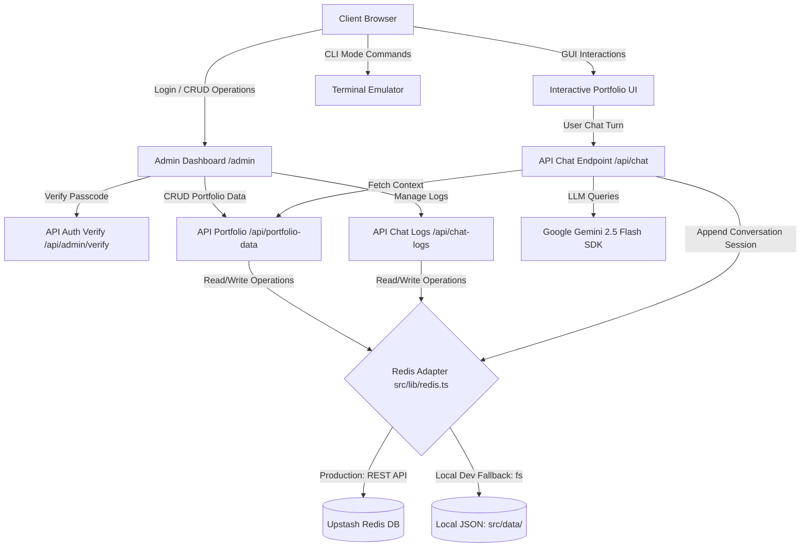

# 🏔️ Prabesh Shah — Autonomous Portfolio & AI Assistant

[](https://nextjs.org/)
[](https://www.typescriptlang.org/)
[](https://upstash.com/)
[](https://aistudio.google.com/)
[](https://vercel.com/)

A production-grade, interactive portfolio application built using **Next.js 16** with dynamic **Turbopack** compilation. Features include an AI-powered conversational assistant (JARVISH), a secure password-gated administration dashboard, an offline-compatible serverless database adapter (Upstash Redis), and a retro CLI terminal emulator alongside a premium glassmorphic UI.

---

## 🏗️ System Architecture

The following diagram illustrates how the frontend components, API endpoints, LLM SDK, and Upstash Redis database interact in both local and production modes:



---

## ✨ Features & Capabilities

### 🎨 Design & Interaction
* **Multi-Theme UI** — Switch between 4 custom-tailored color palettes: *Void Aurora* (purple-neon), *Cybernetic Blue* (matrix-teal), *Quant Green* (hacker-green), and *Ember Gold* (cyberpunk-yellow).
* **CLI Emulator Mode** — A fully-featured console interface. Type commands like `help`, `projects`, `whoami`, `themes`, `clear`, or `exit` to interact with the portfolio using a retro shell interface.
* **CRDT Distributed Lab** — Interactive visual sandbox demonstrating real-time document synchronization utilizing mock vector clock causalities, adaptive throttling, and causal conflict resolution.
* **Premium Typography & Motion** — Integrated typography from Google Fonts (Outfit & Inter) coupled with glassmorphism styles, hover micro-interactions, and float animations.

### 🤖 JARVISH AI Assistant
* **Context-Aware** — Powered by `gemini-2.5-flash`. The system prompt is constructed dynamically by reading your latest portfolio data (projects, profile details, and skill nodes), preventing hallucination.
* **Automatic Chat Logging** — Logs visitor interaction sessions atomically. Administrators can inspect conversations in detail directly from the dashboard logs panel.

### 🔐 Administration Panel (`/admin`)
* **Dynamic Configuration** — Modify your personal introductory bio, active metrics, profile credentials, social channels, and project details in real-time.
* **Skills Registry** — Categorize and manage your technical stack, tags, and operational competencies.
* **Session Explorer** — Review conversation transcripts dynamically, inspect message exchanges, and clear logs at the click of a button.

---

## 🗂️ File Layout

```
.
├── vercel.json               # Serverless runtime execution settings & routing
├── next.config.ts            # Next.js configurations
├── package.json              # App metadata and package configuration
├── public/
│   └── avatar.jpg            # Portfolio profile image
└── src/
    ├── lib/
    │   └── redis.ts          # Serverless database adapter with fallback logic
    ├── data/
    │   ├── portfolio.json    # Initial portfolio dataset (local dev storage)
    │   └── chats.json        # Conversational transcripts database (local dev storage)
    └── app/
        ├── page.tsx          # GUI Shell + Terminal Emulator Page
        ├── layout.tsx        # Global fonts, metadata, and body structures
        ├── globals.css       # Design system, themes, and CSS animations
        ├── admin/
        │   └── page.tsx      # Admin Dashboard Panel (gated)
        └── api/
            ├── admin/
            │   └── verify/   # Credential validation route
            ├── chat/         # JARVISH logic handler (Gemini SDK integration)
            ├── chat-logs/    # Logs retrieval and deletion handler
            └── portfolio-data/ # Dynamic portfolio reading and writing handler
```

---

## ⚡ Setup & Development

### 1. Pre-requisites
* Node.js v18 or later
* Google Gemini API Key (obtained from [Google AI Studio](https://aistudio.google.com/))

### 2. Installation
```bash
npm install
```

### 3. Environment Setup
Create a `.env.local` file in the project root:
```env
GEMINI_API_KEY=your_gemini_api_key_here
ADMIN_PASSWORD=your_secure_dashboard_password_here

# Upstash Redis Configuration (Optional for local development, required for Vercel)
# UPSTASH_REDIS_REST_URL=https://your-database.upstash.io
# UPSTASH_REDIS_REST_TOKEN=your_token_here
```

### 4. Running the Dev Server
```bash
npm run dev
```
Open [http://localhost:3000](http://localhost:3000) to inspect the GUI/CLI dashboard.

---

## 🔐 Security & Reliability Core

* **Serverless Compatibility**: Standard Node.js `fs` file writes fail on Vercel's read-only file structure. The system utilizes `src/lib/redis.ts` which automatically defaults to Upstash Redis REST calls in cloud environments and gracefully falls back to local files locally.
* **Server-Side Authorization**: Administrative calls block unauthorized requests on the API boundary using `x-admin-password` headers validated server-side.
* **Input Limits & DoS Mitigation**:
  - Limits incoming chat message payload strings to a maximum of **2,000 characters**.
  - Restricts message context array to a maximum of **30 entries** to prevent payload inflation.
  - Returns appropriate `400 Bad Request` codes if validation thresholds are breached.
* **Atomic Operations**: Deletes and append queries to Upstash Redis are executed transactionally, preventing database lockouts or state corruption.

---

## 🚀 Cloud Deployment (Vercel + Upstash)

### 1. Provision Upstash Redis
1. Visit the [Upstash Console](https://console.upstash.com/) and create a free Redis database.
2. Select your preferred region (e.g., Singapore/Asia region).
3. Under the **REST API** section of your database page, copy the **`UPSTASH_REDIS_REST_URL`** and **`UPSTASH_REDIS_REST_TOKEN`**.

### 2. Deploy on Vercel
1. Push your project files to your GitHub repository.
2. Connect your repository to [Vercel](https://vercel.com).
3. In the project setup panel, click **Environment Variables** and add:
   * `GEMINI_API_KEY`
   * `ADMIN_PASSWORD`
   * `UPSTASH_REDIS_REST_URL`
   * `UPSTASH_REDIS_REST_TOKEN`
4. Click **Deploy**. On the first request, the Redis adapter automatically seeds your database using your default configuration inside `src/data/portfolio.json`.

---

## 🛠️ API Reference Registry

| Method | Endpoint | Auth Header | Description |
|---|---|---|---|
| `GET` | `/api/portfolio-data` | None | Read current portfolio payload |
| `POST` | `/api/portfolio-data` | `x-admin-password` | Update portfolio items |
| `POST` | `/api/chat` | None | Interact with JARVISH Assistant |
| `GET` | `/api/chat-logs` | `x-admin-password` | View conversation session history |
| `DELETE` | `/api/chat-logs` | `x-admin-password` | Clear database chat sessions |
| `POST` | `/api/admin/verify` | None (JSON Body) | Validate dashboard passcode |

---

## 📬 Contact Details
* **Developer**: Prabesh Shah
* **Email**: [contact@prabeshshah.dev](mailto:contact@prabeshshah.dev)
* **GitHub**: [github.com/Prabesh1919](https://github.com/Prabesh1919)
* **LinkedIn**: [linkedin.com/in/prabeshshah](https://linkedin.com)
