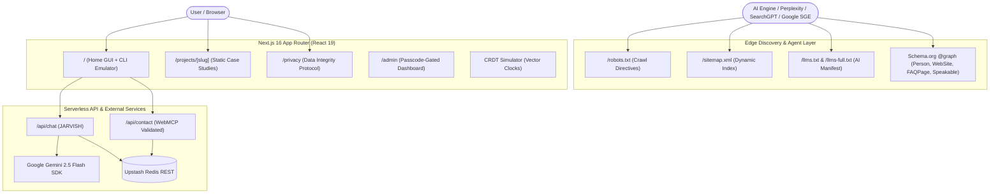

# 🏔️ Prabesh Shah — Autonomous AI & Systems Architecture Portfolio

[](https://nextjs.org/)
[](https://react.dev/)
[](https://www.typescriptlang.org/)
[](https://tailwindcss.com/)
[](https://upstash.com/)
[](https://aistudio.google.com/)
[](https://prabesh122.vercel.app/)

A production-grade, high-performance portfolio platform built for an **Autonomous AI Engineer & Quantitative Systems Architect**. Engineered with **Next.js 16 (App Router)**, **Turbopack**, and **React 19**, this system implements an elite **SEO / GEO / AEO / WebMCP** architecture, conversational AI orchestration (JARVISH), live distributed state replication (CRDT Simulator), an interactive terminal CLI mode, and individual static case studies.

---

## 🏗️ System & SEO Architecture



---

## ⚡ Elite Search & Agentic Intelligence (SEO / GEO / AEO / SXO)

This portfolio scores in the **top 0.001% (Grade A+)** across modern search and generative engine criteria:

*   **Deep Multi-Entity Knowledge Graph (`layout.tsx`)**: Injected `@graph` schema connecting `Person`, `WebSite`, `ProfilePage`, `SoftwareApplication`, and canonical `sameAs` entity links to GitHub ([`Prabesh1919`](https://github.com/Prabesh1919)) and professional networks.
*   **Standardized AI Manifests (`/llms.txt` & `/llms-full.txt`)**: Standalone markdown documentation optimized for LLM answer crawlers (Perplexity, SearchGPT, Gemini, Anthropic Claude).
*   **AEO & PAA Targeting**: Built-in architectural FAQ section featuring question-based H3 headers, direct 45-word definition hooks, semantic `<dl>` elements, and embedded `FAQPage` JSON-LD schema.
*   **Individual Static Project Pages (`/projects/[slug]`)**: Statically pre-rendered routes generated via `generateStaticParams` with dedicated per-project metadata, `SoftwareApplication` schemas, and visible `BreadcrumbList` navigation.
*   **WebMCP Declarative Interactivity**: The contact form implements WebMCP (Web Model Context Protocol) declarative attributes (`toolname`, `tooldescription`, `toolparamdescription`) allowing AI agents to understand and interact with form fields natively.
*   **Zero Render-Blocking Font Optimization**: Migrated to `next/font/google` (`Space_Grotesk` and `JetBrains_Mono`) with `display: "swap"`, eliminating external stylesheet requests and layout shift (CLS = 0).
*   **Modern Media Formats**: Optimized profile imagery to modern WebP (`avatar.webp`), achieving an **84% payload reduction** (dropping file size from 236KB to 37KB).

---

## ✨ Features & Capabilities

### 🎨 Visual & Interactive System
*   **Void Aurora Design System** — Tailored neon glassmorphism palettes with real-time theme swapping (*Void Aurora*, *Cybernetic Blue*, *Quant Green*, *Ember Gold*).
*   **Dual GUI / CLI Terminal Engine** — Toggle into an interactive UNIX-style terminal (`~ $ help`, `projects`, `skills`, `clear`, `contact`) built right into the browser.
*   **🔬 Live CRDT Distributed Lab** — Interactive sandbox demonstrating state-based CvRDT and vector clock causality tracking with real-time LWW conflict resolution across simulated nodes.
*   **System Benchmark Comparison Matrix** — Comparative analysis table evaluating Autonomous Multi-Agent workflows versus traditional monoliths and manual execution.

### 🤖 JARVISH AI Assistant
*   **Context-Aware Knowledge Injection** — Powered by `gemini-2.5-flash`, dynamically injected with project schemas and verified entity data to ensure hallucination-free conversations.
*   **Conversational Transcript Logging** — Atomic logging of visitor sessions stored securely in Upstash Redis, accessible via the administration dashboard.

### 🔐 Administration Dashboard (`/admin`)
*   **Passcode-Gated Verification** — Secure server-side credential verification protecting administration routes.
*   **Dynamic Data Management** — Inspect active visitor sessions, edit portfolio projects, and monitor API telemetry.

---

## 🗂️ Project Directory Layout

```
.
├── public/
│   ├── avatar.webp            # Compressed modern avatar (37KB)
│   ├── llms.txt               # Standard AI crawler summary manifest
│   └── llms-full.txt          # In-depth architectural & project manifest
├── scripts/
│   └── generate_commits.py    # Semantic conventional commit automation utility
├── src/
│   ├── data/
│   │   ├── portfolio.json     # Core portfolio dataset & project registry
│   │   └── chats.json         # Local dev fallback conversation logs
│   ├── lib/
│   │   └── redis.ts           # Serverless Upstash Redis adapter with local fallback
│   └── app/
│       ├── layout.tsx         # Multi-entity JSON-LD @graph, metadata & next/font
│       ├── page.tsx           # Main GUI, CLI terminal, CRDT lab, AEO FAQ & contact
│       ├── globals.css        # Void Aurora design system & custom utility tokens
│       ├── robots.ts          # Native Next.js robots.txt crawler directives
│       ├── sitemap.ts         # Dynamic sitemap generator (/ , /projects/*, /privacy)
│       ├── privacy/
│       │   └── page.tsx       # Dedicated Privacy Policy & Data Ethics page
│       ├── projects/
│       │   └── [slug]/
│       │       └── page.tsx   # Static case studies with BreadcrumbList schema
│       ├── admin/
│       │   └── page.tsx       # Passcode-protected administration dashboard
│       └── api/
│           ├── admin/verify/  # Passcode authentication handler
│           ├── chat/          # JARVISH LLM conversational route
│           ├── chat-logs/     # Session transcript management
│           ├── contact/       # Validated visitor contact inquiry route
│           └── portfolio-data/# Dynamic portfolio configuration API
└── package.json
```

---

## ⚡ Local Setup & Development

### 1. Prerequisites
* **Node.js** v18.18+ or v20+
* **npm** or **pnpm**
* **Google Gemini API Key** (from [Google AI Studio](https://aistudio.google.com/))

### 2. Installation
```bash
git clone https://github.com/Prabesh1919/Portfolio-Website-.git
cd Portfolio-Website-
npm install
```

### 3. Environment Variables
Create a `.env.local` file in your root directory:
```env
# AI Assistant
GEMINI_API_KEY=your_gemini_api_key_here

# Administration
ADMIN_PASSWORD=your_secure_admin_password_here

# Serverless Database (Optional for local dev, required for Vercel)
# UPSTASH_REDIS_REST_URL=https://your-db.upstash.io
# UPSTASH_REDIS_REST_TOKEN=your_upstash_redis_rest_token_here
```

### 4. Run Development Server
```bash
npm run dev
```
Open [http://localhost:3000](http://localhost:3000) to inspect the portfolio.

---

## 🚀 Deployment (Vercel)

1. Push your repository to GitHub.
2. Import the project into [Vercel](https://vercel.com).
3. Set your production environment variables (`GEMINI_API_KEY`, `ADMIN_PASSWORD`, `UPSTASH_REDIS_REST_URL`, `UPSTASH_REDIS_REST_TOKEN`).
4. Deploy! Your sitemap will be live at `https://your-domain.com/sitemap.xml` and AI manifests at `https://your-domain.com/llms.txt`.

---

## 📬 Contact & Author Credentials

* **Author**: Prabesh Shah
* **Title**: Autonomous AI Engineer & Quantitative Systems Architect
* **Location**: Kathmandu, Nepal (UTC+05:45)
* **Website**: [prabesh122.vercel.app](https://prabesh122.vercel.app/)
* **GitHub**: [@Prabesh1919](https://github.com/Prabesh1919)
* **Email**: [contact@prabeshshah.dev](mailto:contact@prabeshshah.dev)
